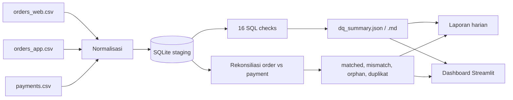

# Data Quality QA Portfolio - Rekonsiliasi Order & Payment

Pipeline Data Quality Assurance end-to-end untuk data order dan payment
multichannel: normalisasi, 16 SQL check, rekonsiliasi, laporan harian, dan
dashboard. Dibuat untuk menunjukkan kompetensi **Data Quality Assurance /
Data Analyst**: menjaga integritas data, menelusuri akar masalah, dan
mengomunikasikan temuan dengan angka.

- Python 3.10+ | SQL (SQLite) | Plotly | Streamlit | pytest
- 29 automated test, 16 SQL check, 2 dataset (kotor dan bersih)
- Pipeline inti tanpa Docker, tanpa API key, tanpa database eksternal

## Ringkasan hasil

| Metrik | Dataset kotor | Dataset bersih |
|---|---:|---:|
| Baris order | 230 | 220 |
| Order unik | 220 | 220 |
| Order matched | 190 | 220 |
| Check lulus | 2/16 (12,5%) | 16/16 (100%) |
| Duplikat dalam file | 7 | 0 |
| Duplikat antar channel | 3 | 0 |
| Amount mismatch | 12 | 0 |
| Order tanpa pembayaran | 18 | 0 |
| Pembayaran yatim | 6 | 0 |
| Pembayaran ganda | 4 | 0 |
| Nominal berisiko | Rp 5.118.000 | Rp 0 |

Dataset kotor **sengaja** dibuat mengandung satu anomali per kategori untuk
membuktikan deteksi bekerja. Dataset bersih dipakai untuk membuktikan pipeline
**tidak menghasilkan false positive** - ini bagian yang sering dilupakan.

## Kenapa proyek ini relevan

Posisi Data Quality Assurance bukan soal menulis aplikasi, tetapi soal:

- merapikan data mentah dari beberapa sumber dengan format berbeda;
- memastikan data akurat, konsisten, dan lengkap sebelum dipakai tim lain;
- mendeteksi anomali lebih awal dan mengeskalasikannya dengan jelas;
- menyusun laporan dan dokumentasi yang bisa dipertanggungjawabkan.

Proyek ini memetakan langsung ke pekerjaan tersebut:

| Kebutuhan | Implementasi |
|---|---|
| Penanganan dan pemeliharaan data | Loader + normalisasi id, tanggal, nominal, channel |
| Penarikan data | Query SQL + template `general_request.sql` |
| Rekonsiliasi data | Pencocokan order vs payment per `order_id` |
| Verifikasi multichannel | Deteksi order yang muncul di WEB dan APP |
| Monitoring stabilitas | 16 check dengan severity dan freshness |
| Investigasi keluhan | Studi kasus selisih omzet 2,3% |
| Pelaporan dan dokumentasi | Laporan harian, SOP, panduan teknis |

## Arsitektur



Alur: **raw -> normalisasi -> staging -> checks + rekonsiliasi -> laporan ->
dashboard**. Baris yang gagal tidak dihapus diam-diam; dicatat sebagai
quarantine agar bisa ditelusuri.

## 16 SQL check

| Kategori | Check | Severity |
|---|---|---|
| Uniqueness | `duplicate_order_id` | critical |
| Uniqueness | `duplicate_payment_per_order` | critical |
| Completeness | `missing_customer_id` | warning |
| Completeness | `missing_order_date` | critical |
| Completeness | `missing_amount` | critical |
| Completeness | `missing_paid_at` | warning |
| Validity | `unparseable_order_date` | critical |
| Validity | `non_positive_amount` | critical |
| Validity | `non_positive_paid_amount` | critical |
| Validity | `invalid_status` | critical |
| Validity | `future_order_date` | critical |
| Consistency | `amount_mismatch` | critical |
| Consistency | `orphan_payment` | critical |
| Consistency | `payment_before_order` | warning |
| Timeliness | `stale_data` | warning |
| Timeliness | `late_payment` | info |

Setiap check adalah satu file `.sql` dengan header metadata, sehingga aturan
bisnis mudah direview dan ditambah tanpa mengubah kode Python.

## Temuan utama (dataset kotor)

1. **10 baris order ganda** - 7 di dalam file yang sama dan 3 muncul di dua
   channel. Penyebab: tidak ada idempotency key dan normalisasi kunci tidak
   konsisten (`ORD-1001` vs `ord-1001` vs ` ORD-1001 `).
2. **6 pembayaran yatim** - pembayaran tanpa order induk, berpotensi
   menggembungkan omzet.
3. **12 amount mismatch** - total pembayaran tidak sama dengan nominal order,
   termasuk 4 pembayaran ganda (double charge).
4. **18 order tanpa pembayaran valid** - termasuk pembayaran berstatus FAILED.
5. **Nominal berisiko Rp 5.118.000** - dihitung dari selisih mismatch,
   pembayaran yatim, dan order yang belum dibayar.

## Rekomendasi

- Terapkan **constraint unik** pada `order_id` dan foreign key pada
  `payments.order_id` di lapisan curated.
- Tambahkan **idempotency key** saat ingest agar file yang dikirim ulang tidak
  menciptakan duplikat.
- Normalisasi id, tanggal, nominal, dan channel **sebelum** join.
- Pisahkan baris gagal ke **quarantine** dan tampilkan di dashboard.
- Jalankan **rekonsiliasi harian** dengan ambang severity dan matriks eskalasi.
- Tambahkan **alerting** untuk critical check (belum termasuk di proyek ini).

## Cara menjalankan

```bash
python -m venv .venv
# Windows
.venv\Scripts\activate
# Linux/macOS
source .venv/bin/activate

pip install -r requirements.txt

# dataset kotor dan bersih
python scripts/generate_sample_data.py
python scripts/generate_sample_data.py --clean

# pipeline
python scripts/run_pipeline.py --as-of 2026-10-31
python scripts/run_pipeline.py --raw-dir data/clean --out-dir reports_clean --as-of 2026-10-31

# test
python -m pytest -q

# dashboard
streamlit run streamlit/dashboard.py
```

Output utama:

- `reports/daily_report.md` - laporan harian siap kirim.
- `reports/dq_summary.md` - tabel 16 check beserta sampel baris gagal.
- `reports/dq_summary.json` - data untuk dashboard.
- `reports/processed/*.csv` - matched, mismatch, orphan, duplikat, rejected.
- `reports_clean/*` - hasil pada dataset bersih (16/16 PASS).

## Dashboard

Tema kustom dengan hero header, 5 kartu KPI, gauge pass rate, donut status,
bar chart check gagal, filter, dan tombol unduh.

- **Ringkasan** - KPI, pass rate, distribusi status, check gagal, dampak nominal.
- **Checks** - filter status/severity/pencarian, tabel berwarna, sampel baris gagal.
- **Rekonsiliasi** - mismatch per channel, pembayaran yatim, order belum dibayar.
- **Data Bermasalah** - baris ditolak, duplikat, dan pembayaran ganda.
- **Laporan Harian** - render `daily_report.md` siap kirim.

Ganti dataset lewat sidebar (Dirty/Clean) untuk membandingkan 12,5% vs 100%.

## Full-stack app (FastAPI + React)

Aplikasi upload dengan template CSV, validasi otomatis, job async, dan dashboard
hasil. Panduan lengkap: `fullstack/README.md` dan `docs/fullstack-panduan.md`.

```powershell
powershell -ExecutionPolicy Bypass -File scripts\run_fullstack.ps1
```

- **Frontend** - React + Tailwind + Recharts (`fullstack/frontend`).
- **Backend** - FastAPI + SQLAlchemy, SQLite lokal atau Postgres (`fullstack/backend`).
- **Satu skema** - template, validasi, dan loader memakai `src/dq/schema.py`.
- **Deploy** - satu service lewat `fullstack/Dockerfile` + `render.yaml`.
- **Demo instan** - tambahkan `?demo=1` pada URL untuk langsung menjalankan data demo.

## Struktur repo

```text
.
|-- data/
|   |-- raw/                  # dataset kotor + ground truth
|   `-- clean/                # dataset bersih untuk uji false positive
|-- docs/
|   |-- SOP_verifikasi_data_harian.md
|   |-- studi_kasus_investigasi.md
|   |-- panduan_teknis.md
|   |-- panduan_interview.md
|   |-- keputusan-desain.md
|   |-- menghubungkan-proyek-lama.md
|   |-- fullstack-panduan.md
|   `-- cv_bullets.md
|-- fullstack/
|   |-- backend/              # FastAPI, validasi, job runner, test API
|   |-- frontend/             # React + Tailwind + Recharts
|   `-- Dockerfile
|-- reports/                  # output dataset kotor
|-- reports_clean/            # output dataset bersih
|-- scripts/
|   |-- generate_sample_data.py
|   |-- run_pipeline.py
|   |-- run_fullstack.ps1
|   `-- run_fullstack_prod.ps1
|-- sql/
|   |-- schema.sql
|   |-- general_request_template.sql
|   `-- checks/               # 16 file check
|-- src/dq/
|   |-- schema.py             # sumber kebenaran skema + template
|   |-- csv_utils.py          # deteksi delimiter + fallback encoding
|   |-- normalize.py
|   |-- loader.py
|   |-- reconcile.py
|   |-- checks.py
|   |-- report.py
|   `-- run.py
|-- streamlit/dashboard.py
|-- .streamlit/config.toml
|-- render.yaml
`-- tests/                    # 29 test pipeline + dashboard
```

## Testing

```bash
python -m pytest -q
# 29 passed

cd fullstack/backend
python -m pytest -q
# 10 passed (API: template, validasi, upload + demo end-to-end, path safety)

cd ../frontend
npm run typecheck
npm run build
```

Cakupan test:

- normalisasi nominal (`Rp 1.500.000`, `1.500.000,00`, `(75.000)`), tanggal
  (`DD/MM/YYYY`, ISO, timestamp), id, channel, status;
- klasifikasi rekonsiliasi (matched, mismatch, orphan, duplikat, unpaid);
- setiap anomali benar-benar terdeteksi oleh check;
- **end-to-end**: hasil pipeline cocok dengan ground truth, dan dataset bersih
  menghasilkan 16/16 PASS;
- dashboard Streamlit dirender tanpa exception (Streamlit AppTest).

## Dokumentasi

- [SOP verifikasi data harian](docs/SOP_verifikasi_data_harian.md)
- [Studi kasus investigasi selisih omzet](docs/studi_kasus_investigasi.md)
- [Panduan teknis dan data dictionary](docs/panduan_teknis.md)
- [Panduan interview](docs/panduan_interview.md)
- [Keputusan desain](docs/keputusan-desain.md)
- [Menghubungkan dengan proyek lama](docs/menghubungkan-proyek-lama.md)
- [Bullet CV dan LinkedIn](docs/cv_bullets.md)

## Batasan

- Dataset sintetis, bukan data produksi.
- SQLite dipakai agar portabel; produksi sebaiknya PostgreSQL.
- Belum ada scheduler dan alerting (Slack/email).
- Dashboard dijalankan lokal; belum di-deploy publik.

Batasan ini disebut terbuka agar penilaian berfokus pada cara berpikir, bukan
pada klaim yang berlebihan.

## Lisensi

MIT - lihat [LICENSE](LICENSE).


