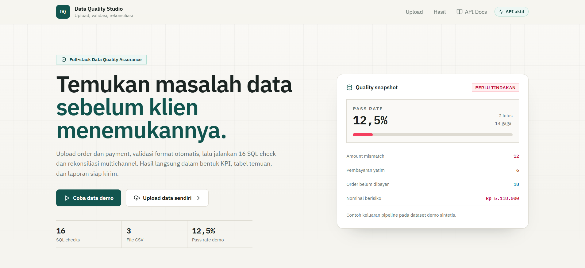
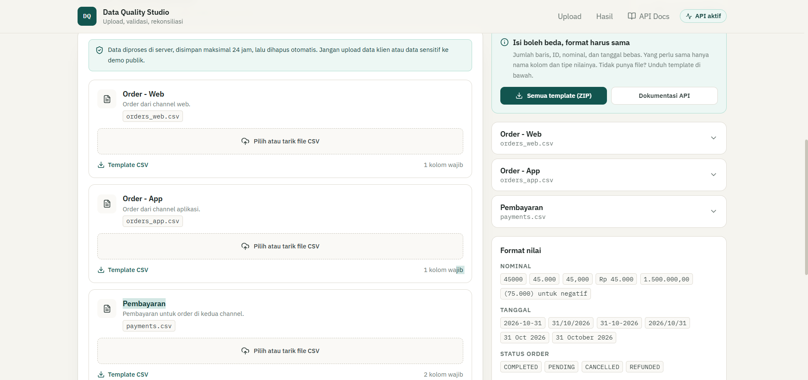
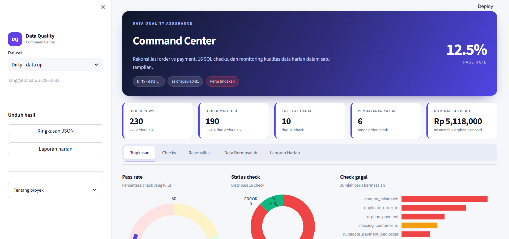
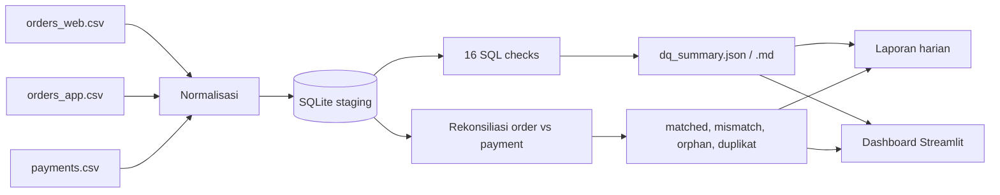

# Multichannel Order & Payment Reconciliation Pipeline
### Data Engineering & Data Quality Portfolio

Pipeline Data Engineering & Data Quality end-to-end untuk data transaksi order dan payment multichannel (Web & Mobile App): ingestion, normalisasi data mentah, 16 automated SQL audit checks, rekonsiliasi finansial, reporting otomatis, serta visualisasi via Dashboard Full-Stack (FastAPI + React) dan Streamlit.

Proyek ini dibangun untuk mendemonstrasikan kompetensi **Data Engineer**:
- **Data Integration & ETL/ELT**: Ekstraksi dan pembersihan data dari berbagai sumber dengan format heterogen.
- **Data Integrity & Reconciliation**: Memastikan transaksi matched, mendeteksi kebocoran nominal, *orphan payments*, dan *double charge*.
- **Data Quality Framework**: Audit kualitas data otomatis berbasis SQL sebelum masuk ke data warehouse / lapisan analitik.
- **Full-Stack Data Application**: Integrasi backend pipeline asinkronus ke frontend analitik yang interaktif.

- **Tech Stack**: Python 3.10+ | SQL (SQLite/PostgreSQL) | FastAPI | React + Vite + Tailwind | Streamlit | pytest
- **Pengujian**: 39 automated tests (29 pipeline + 10 API), 16 SQL checks, 2 skenario dataset (kotor vs bersih)

---

## 📸 Tampilan Antarmuka (Screenshots)

Berikut preview antarmuka aplikasi pemantauan rekonsiliasi dan kualitas data:

### 1. Full-Stack Data Studio (React + Vite + Tailwind + Recharts)
Aplikasi interaktif untuk upload batch file CSV, validasi skema otomatis secara async, inspeksi status checks, serta breakdown visual rekonsiliasi.


*Screenshot 1: Tampilan Dashboard Utama Full-Stack Studio (Ringkasan Run, KPI Metrik, dan Visualisasi Recharts)*


*Screenshot 2: Fitur upload CSV multichannel, validasi header & preview anomali secara real-time*

---

### 2. Streamlit Analytical Dashboard
Dashboard eksploratif untuk tim audit & data analyst dengan filter interaktif, rincian 16 SQL check, dan download laporan harian.


*Screenshot 3: Streamlit Data Quality & Reconciliation Dashboard (KPI, Pass Rate Gauge, & Tab Investigasi)*

> 💡 *File tangkapan layar dapat Anda letakkan di folder `docs/screenshots/` dengan nama `fullstack-dashboard.png`, `fullstack-upload.png`, dan `streamlit-dashboard.png`.*

---

## Ringkasan hasil

| Metrik | Dataset kotor | Dataset bersih |
|---|---:|---:|
| Baris order | 230 | 220 |
| Order unik | 220 | 220 |
| Order matched | 190 | 220 |
| Check lulus | 2/16 (12,5%) | 16/16 (100%) |
| Duplikat dalam file | 7 | 0 |
| Duplikat antar channel | 3 | 0 |
| Amount mismatch | 12 | 0 |
| Order tanpa pembayaran | 18 | 0 |
| Pembayaran yatim | 6 | 0 |
| Pembayaran ganda | 4 | 0 |
| Nominal berisiko | Rp 5.118.000 | Rp 0 |

Dataset kotor **sengaja** dibuat mengandung satu anomali per kategori untuk
membuktikan deteksi bekerja. Dataset bersih dipakai untuk membuktikan pipeline
**tidak menghasilkan false positive** - ini bagian yang sering dilupakan.

## Kenapa proyek ini relevan

Posisi Data Quality Assurance bukan soal menulis aplikasi, tetapi soal:

- merapikan data mentah dari beberapa sumber dengan format berbeda;
- memastikan data akurat, konsisten, dan lengkap sebelum dipakai tim lain;
- mendeteksi anomali lebih awal dan mengeskalasikannya dengan jelas;
- menyusun laporan dan dokumentasi yang bisa dipertanggungjawabkan.

Proyek ini memetakan langsung ke pekerjaan tersebut:

| Kebutuhan | Implementasi |
|---|---|
| Penanganan dan pemeliharaan data | Loader + normalisasi id, tanggal, nominal, channel |
| Penarikan data | Query SQL + template `general_request.sql` |
| Rekonsiliasi data | Pencocokan order vs payment per `order_id` |
| Verifikasi multichannel | Deteksi order yang muncul di WEB dan APP |
| Monitoring stabilitas | 16 check dengan severity dan freshness |
| Investigasi keluhan | Studi kasus selisih omzet 2,3% |
| Pelaporan dan dokumentasi | Laporan harian, SOP, panduan teknis |

## Arsitektur



Alur: **raw -> normalisasi -> staging -> checks + rekonsiliasi -> laporan ->
dashboard**. Baris yang gagal tidak dihapus diam-diam; dicatat sebagai
quarantine agar bisa ditelusuri.

## 16 SQL check

| Kategori | Check | Severity |
|---|---|---|
| Uniqueness | `duplicate_order_id` | critical |
| Uniqueness | `duplicate_payment_per_order` | critical |
| Completeness | `missing_customer_id` | warning |
| Completeness | `missing_order_date` | critical |
| Completeness | `missing_amount` | critical |
| Completeness | `missing_paid_at` | warning |
| Validity | `unparseable_order_date` | critical |
| Validity | `non_positive_amount` | critical |
| Validity | `non_positive_paid_amount` | critical |
| Validity | `invalid_status` | critical |
| Validity | `future_order_date` | critical |
| Consistency | `amount_mismatch` | critical |
| Consistency | `orphan_payment` | critical |
| Consistency | `payment_before_order` | warning |
| Timeliness | `stale_data` | warning |
| Timeliness | `late_payment` | info |

Setiap check adalah satu file `.sql` dengan header metadata, sehingga aturan
bisnis mudah direview dan ditambah tanpa mengubah kode Python.

## Temuan utama (dataset kotor)

1. **10 baris order ganda** - 7 di dalam file yang sama dan 3 muncul di dua
   channel. Penyebab: tidak ada idempotency key dan normalisasi kunci tidak
   konsisten (`ORD-1001` vs `ord-1001` vs ` ORD-1001 `).
2. **6 pembayaran yatim** - pembayaran tanpa order induk, berpotensi
   menggembungkan omzet.
3. **12 amount mismatch** - total pembayaran tidak sama dengan nominal order,
   termasuk 4 pembayaran ganda (double charge).
4. **18 order tanpa pembayaran valid** - termasuk pembayaran berstatus FAILED.
5. **Nominal berisiko Rp 5.118.000** - dihitung dari selisih mismatch,
   pembayaran yatim, dan order yang belum dibayar.

## Rekomendasi

- Terapkan **constraint unik** pada `order_id` dan foreign key pada
  `payments.order_id` di lapisan curated.
- Tambahkan **idempotency key** saat ingest agar file yang dikirim ulang tidak
  menciptakan duplikat.
- Normalisasi id, tanggal, nominal, dan channel **sebelum** join.
- Pisahkan baris gagal ke **quarantine** dan tampilkan di dashboard.
- Jalankan **rekonsiliasi harian** dengan ambang severity dan matriks eskalasi.
- Tambahkan **alerting** untuk critical check (belum termasuk di proyek ini).

## 🚀 Panduan Menjalankan di Komputer Lokal

### Prasyarat
- **Python**: 3.10 atau lebih baru
- **Node.js**: 18 atau lebih baru (dengan `npm`)
- **Git**

---

### 1. Menjalankan Full-Stack App (FastAPI + React)

Aplikasi Full-Stack menggabungkan **FastAPI** di backend (`port 8000`) dan **React Vite + Tailwind** di frontend (`port 5173`).

#### Opsi A: Otomatis via PowerShell Script (Windows)
Jalankan satu perintah dari root folder proyek:
```powershell
powershell -ExecutionPolicy Bypass -File scripts\run_fullstack.ps1
```
*Script ini otomatis menginstal dependensi backend & frontend, lalu menyalakan kedua server secara paralel.*

#### Opsi B: Manual via 2 Terminal (Direkomendasikan untuk Pemahaman & Debugging)

**Terminal 1 — Backend (FastAPI):**
```bash
# 1. Masuk ke direktori backend
cd fullstack/backend

# 2. Buat virtual environment & aktifkan
python -m venv .venv
# Windows (PowerShell / CMD):
.venv\Scripts\activate
# Linux / macOS:
# source .venv/bin/activate

# 3. Install dependensi backend
pip install -r requirements.txt

# 4. Jalankan backend server
python -m uvicorn app.main:app --reload --port 8000
```
- API Server: `http://127.0.0.1:8000`
- Swagger Interactive Docs: `http://127.0.0.1:8000/docs`

**Terminal 2 — Frontend (React + Vite):**
```bash
# 1. Buka terminal baru dan masuk ke direktori frontend
cd fullstack/frontend

# 2. Install dependensi Node.js
npm install

# 3. Jalankan Vite dev server
npm run dev
```
- Frontend UI: `http://127.0.0.1:5173`

> 💡 **Demo Instan:** Buka browser di **`http://127.0.0.1:5173/?demo=1`** untuk langsung menjalankan pipeline dengan dataset demo tanpa perlu upload CSV manual.

---

### 2. Menjalankan Pipeline CLI & Streamlit Dashboard

Jika ingin menguji pipeline data secara batch via CLI dan mengeksplorasi data menggunakan dashboard Streamlit:

```bash
# Dari root directory:
pip install -r requirements.txt

# 1. Generate dataset sintetis (kotor dan bersih)
python scripts/generate_sample_data.py
python scripts/generate_sample_data.py --clean

# 2. Eksekusi data pipeline ETL & rekonsiliasi
python scripts/run_pipeline.py --as-of 2026-10-31
python scripts/run_pipeline.py --raw-dir data/clean --out-dir reports_clean --as-of 2026-10-31

# 3. Jalankan dashboard analitik Streamlit
streamlit run streamlit/dashboard.py
```
Dashboard akan otomatis terbuka pada `http://localhost:8501`.

---

### 3. Menjalankan Automated Testing

Memverifikasi integritas pipeline dan API endpoint:

```bash
# Core Pipeline & DQ Tests (29 tests)
python -m pytest tests/ -q

# Fullstack Backend Tests (10 tests)
cd fullstack/backend
python -m pytest tests/ -q

# Frontend Typecheck
cd ../frontend
npm run typecheck
```

---

## Output Pipeline Utama

- `reports/daily_report.md` - Laporan ringkasan harian siap kirim ke stakeholder.
- `reports/dq_summary.md` - Tabel detail 16 DQ checks beserta sampel baris gagal.
- `reports/dq_summary.json` - Data payload terstruktur untuk konsumsi dashboard.
- `reports/processed/*.csv` - Dataset terpisah: `matched`, `mismatch`, `orphan`, `duplicates`, `rejected`.
- `reports_clean/*` - Hasil pengujian pada data valid (16/16 checks PASS).

## Struktur repo

```text
.
|-- data/
|   |-- raw/                  # dataset kotor + ground truth
|   `-- clean/                # dataset bersih untuk uji false positive
|-- docs/
|   |-- SOP_verifikasi_data_harian.md
|   |-- studi_kasus_investigasi.md
|   |-- panduan_teknis.md
|   |-- panduan_interview.md
|   |-- keputusan-desain.md
|   |-- menghubungkan-proyek-lama.md
|   |-- fullstack-panduan.md
|   `-- cv_bullets.md
|-- fullstack/
|   |-- backend/              # FastAPI, validasi, job runner, test API
|   |-- frontend/             # React + Tailwind + Recharts
|   `-- Dockerfile
|-- reports/                  # output dataset kotor
|-- reports_clean/            # output dataset bersih
|-- scripts/
|   |-- generate_sample_data.py
|   |-- run_pipeline.py
|   |-- run_fullstack.ps1
|   `-- run_fullstack_prod.ps1
|-- sql/
|   |-- schema.sql
|   |-- general_request_template.sql
|   `-- checks/               # 16 file check
|-- src/dq/
|   |-- schema.py             # sumber kebenaran skema + template
|   |-- csv_utils.py          # deteksi delimiter + fallback encoding
|   |-- normalize.py
|   |-- loader.py
|   |-- reconcile.py
|   |-- checks.py
|   |-- report.py
|   `-- run.py
|-- streamlit/dashboard.py
|-- .streamlit/config.toml
|-- render.yaml
`-- tests/                    # 29 test pipeline + dashboard
```

## Testing

```bash
python -m pytest -q
# 29 passed

cd fullstack/backend
python -m pytest -q
# 10 passed (API: template, validasi, upload + demo end-to-end, path safety)

cd ../frontend
npm run typecheck
npm run build
```

Cakupan test:

- normalisasi nominal (`Rp 1.500.000`, `1.500.000,00`, `(75.000)`), tanggal
  (`DD/MM/YYYY`, ISO, timestamp), id, channel, status;
- klasifikasi rekonsiliasi (matched, mismatch, orphan, duplikat, unpaid);
- setiap anomali benar-benar terdeteksi oleh check;
- **end-to-end**: hasil pipeline cocok dengan ground truth, dan dataset bersih
  menghasilkan 16/16 PASS;
- dashboard Streamlit dirender tanpa exception (Streamlit AppTest).

## Dokumentasi

- [SOP verifikasi data harian](docs/SOP_verifikasi_data_harian.md)
- [Studi kasus investigasi selisih omzet](docs/studi_kasus_investigasi.md)
- [Panduan teknis dan data dictionary](docs/panduan_teknis.md)
- [Panduan interview](docs/panduan_interview.md)
- [Keputusan desain](docs/keputusan-desain.md)
- [Menghubungkan dengan proyek lama](docs/menghubungkan-proyek-lama.md)
- [Bullet CV dan LinkedIn](docs/cv_bullets.md)

## Batasan

- Dataset sintetis, bukan data produksi.
- SQLite dipakai agar portabel; produksi sebaiknya PostgreSQL.
- Belum ada scheduler dan alerting (Slack/email).
- Dashboard dijalankan lokal; belum di-deploy publik.

Batasan ini disebut terbuka agar penilaian berfokus pada cara berpikir, bukan
pada klaim yang berlebihan.

## Lisensi

MIT - lihat [LICENSE](LICENSE).


